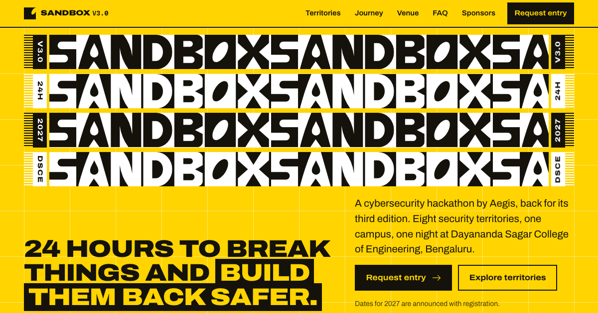

<div align="center">


# SandBox v3.0

**24 hours to break things and build them back safer.**

The website for SandBox v3.0, a 24-hour cybersecurity hackathon by Aegis at<br />
Dayananda Sagar College of Engineering, Bengaluru, in 2027.

[**Live site →**](https://sandbox-v3.vercel.app) &nbsp;·&nbsp; [Logo lab](https://sandbox-v3.vercel.app/logo-lab.html) &nbsp;·&nbsp; [Design system](DESIGN.md)


<br />



</div>

<br />

## What's inside

| Section | What it does |
|---|---|
| **Hero** | Stacked strips repeat a custom SANDBOX wordmark. Each letter starts as a sealed box and carves open. On scroll, the strips shear apart and a box grows to fill the screen. |
| **The loop** | Build, Break, Experiment, Repeat. The active word stretches from narrow to wide. |
| **Territories** | Eight security tracks, Z-01 to Z-08, as a tab grid with a briefing panel. |
| **Journey** | Nine phases in three legs: before, inside the sandbox, and after. |
| **Live ops** | A countdown to hour zero that becomes a live board during the event: elapsed time, a 24-hour track, the current phase, and announcements. |
| **Archive** | SandBox v1.0 and v2.0 as film strips of photos. |
| **Venue** | A poster map of the streets around DSCE, with a switch to Google Maps. |
| **FAQ, sponsors, register** | Answers, open sponsor slots, and the request-entry steps. |

> **Sample data:** The event date, live schedule, announcements, archive photos, and archive figures are placeholders. The site labels each one as a sample. Replace them in `src/data.ts`.

<br />

## Run it locally

You need Node.js 22 or later.

1. Install the dependencies.

   ```bash
   npm install
   ```

2. Start the dev server.

   ```bash
   npm run dev
   ```

3. Open http://localhost:5173.

To test on a phone on the same Wi-Fi network, run `npx vite --host` and open the network address it prints.

### Scripts

| Command | What it does |
|---|---|
| `npm run dev` | Starts the dev server with hot reload. |
| `npm run build` | Type-checks the code, then builds the site into `dist/`. |
| `npm run preview` | Serves the built site from `dist/`. |
| `npm run ship` | Builds, pushes `main` to GitHub, and deploys to Vercel production. |

<br />

## How it's built

| Layer | Choice |
|---|---|
| Framework | React 19, Vite 8, TypeScript in strict mode |
| Animation | [Motion](https://motion.dev) (formerly Framer Motion), imported from `motion/react` |
| Smooth scroll | [Lenis](https://github.com/darkroomengineering/lenis) |
| Styling | Plain CSS with custom properties, in `src/styles.css` |
| Fonts | Archivo (variable width and weight) and Martian Mono, self-hosted through Fontsource |
| Map data | OpenStreetMap, through the Overpass API |
| Hosting | Vercel |

### Project layout

```text
sandbox-v3/
├── index.html              The site's entry page
├── logo-lab.html           A page that compares logo candidates
├── src/
│   ├── App.tsx             Section order
│   ├── data.ts             All copy and sample data
│   ├── styles.css          Tokens, palettes, and every section's styles
│   ├── components/         One file per section, plus shared parts
│   │   ├── Wordmark.tsx    The carved SANDBOX wordmark
│   │   ├── Mark.tsx        The SBv3 monogram
│   │   ├── Strip.tsx       Banner strips, strip headings, phrase strips
│   │   ├── Clock.tsx       The shared event clock for Live ops
│   │   └── …
│   ├── lab/                The logo lab
│   └── assets/
│       └── venue-map.json  Street paths for the venue map
├── scripts/
│   └── build-venue-map.py  Rebuilds venue-map.json from OpenStreetMap
├── public/                 Favicon and share image
├── legacy/                 The earlier static draft
├── DESIGN.md               The design system and decision log
└── PRODUCT.md              Product facts and constraints
```

<br />

## The design system

The full system lives in [`DESIGN.md`](DESIGN.md). These are the short rules.

- **Yellow stays.** Yellow, or a shade of it, is the brand colour in every palette.
- **Boxes and carves.** The wordmark, the SBv3 monogram, and the strips all start as square boxes with shapes cut out of them.
- **Square corners.** No element has rounded corners.
- **Two typefaces.** Archivo sets every word. Martian Mono sets only codes, numbers, and coordinates.
- **One motion per section.** Motion follows the containment theme: seal, carve, shear, breach.
- **Reduced motion.** Every animation respects the visitor's reduced-motion setting.

### Palettes (under review)

The site ships eight palettes for team feedback. A bar at the bottom-left switches them, and the URL keeps the choice.

| Palette | Pairs yellow with | Preview |
|---|---|---|
| Signal (current) | Near-black | [`?palette=signal`](https://sandbox-v3.vercel.app/?palette=signal) |
| Honey & Indigo | Indigo | [`?palette=honey`](https://sandbox-v3.vercel.app/?palette=honey) |
| Lemon & Lilac | Soft purple | [`?palette=lilac`](https://sandbox-v3.vercel.app/?palette=lilac) |
| Sun & Cobalt | Navy and cobalt | [`?palette=cobalt`](https://sandbox-v3.vercel.app/?palette=cobalt) |
| Lemon & Teal | Deep teal | [`?palette=citrus`](https://sandbox-v3.vercel.app/?palette=citrus) |
| Butter & Forest | Forest green | [`?palette=forest`](https://sandbox-v3.vercel.app/?palette=forest) |
| Marigold & Plum | Plum and vermilion | [`?palette=marigold`](https://sandbox-v3.vercel.app/?palette=marigold) |
| Mustard & Cocoa | Espresso brown | [`?palette=cocoa`](https://sandbox-v3.vercel.app/?palette=cocoa) |

Each palette is a block of custom properties at the end of `src/styles.css`. Once the team picks one, it becomes the default and the switcher goes away.

<br />

## Common tasks

### Change the event details

1. Open `src/data.ts`.
2. Edit `EVENT.start` to set hour zero, and set `sample` to `false`.
3. Edit `LIVE_PHASES` and `ANNOUNCEMENTS` to match the real schedule.
4. Edit `EDITIONS` with real years, figures, and photo captions.

### Rebuild the venue map

The script fetches streets, water, parks, and the campus around DSCE from OpenStreetMap.

```bash
python3 -I scripts/build-venue-map.py
```

The public Overpass servers can be slow. The script tries three mirrors and retries each one.

### Ship a change

The Vercel Hobby plan cannot link a private organisation repository. Each change is pushed and deployed as two separate steps.

1. Commit the change on `main`.
2. Run `npm run ship`.

<br />

## Credits

- **Map data:** © [OpenStreetMap contributors](https://www.openstreetmap.org/copyright), available under the Open Database License.
- **Map style:** The venue map follows the idea and the `warm_beige` palette of [maptoposter](https://github.com/originalankur/maptoposter) by originalankur.
- **Fonts:** [Archivo](https://fonts.google.com/specimen/Archivo) and [Martian Mono](https://fonts.google.com/specimen/Martian+Mono), under the SIL Open Font License.
- **Design references:** [awesome-design-md](https://github.com/VoltAgent/awesome-design-md) by VoltAgent shaped the format of `DESIGN.md`.

<br />

<div align="center">

<sub>Built by Aegis for SandBox v3.0 · Dayananda Sagar College of Engineering, Bengaluru</sub>

</div>
